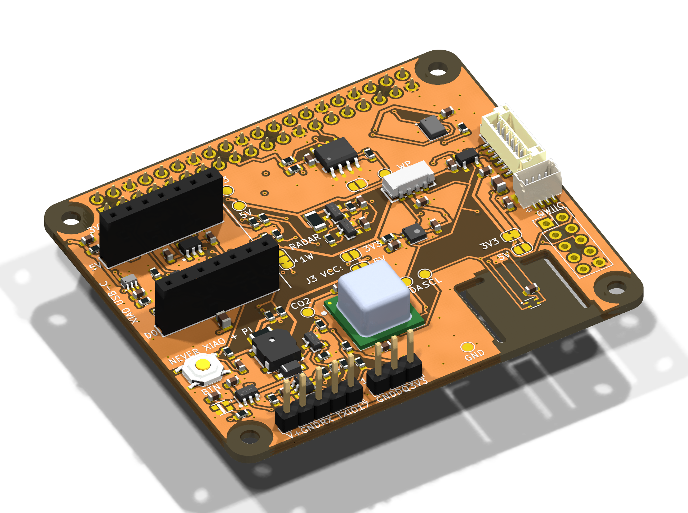

# Sensor HAT v3 "Universal"

*Deutsch (ausführliche Anleitung): [README.de.md](README.de.md)*

An open-hardware indoor-environment sensor board, designed in KiCad 10 (65 × 56 mm, 4 layers). It runs in one of two modes, **never both at once**:

1. **HAT for Raspberry Pi** 2, 3, 4 and 5, with a HAT+ ID EEPROM and Python.
2. **Standalone** with a plug-in **Seeed Studio XIAO ESP32-S3, -C3 or -C6** (not included). It is powered over the XIAO's USB-C, runs ESPHome and shows up in Home Assistant.



> **Status:** the design is complete. KiCad ERC and DRC report no errors, and the ESPHome configs validate. **It has not been tested in hardware yet.** Build prototypes before ordering in quantity.

**Sponsor:** the prototype PCBs are sponsored by [AISLER](https://aisler.net), a PCB manufacturer in Germany. Thank you! The rectangle on the bottom silkscreen is AISLER's logo placeholder, which they replace with their logo during fabrication.

## What is on the board

| Function | Part | I²C address / Pi GPIO / XIAO pin |
|---|---|---|
| CO₂ (photoacoustic, not an eCO₂ estimate) | Sensirion SCD41, own 3.3 V regulator | 0x62 |
| Temperature, humidity | Sensirion SHT40 on a milled, thermally isolated island | 0x44 |
| VOC and NOx index | Sensirion SGP41 | 0x59 |
| Ambient light (lux) | Vishay VEML7700 | 0x10 |
| Sound level | TDK ICS-43434 I²S microphone | Pi GPIO18/19/20, XIAO D1/D0/D2 |
| RGB status LED (e.g. CO₂ traffic light) | WS2812B-2020 with 5 V level shifter | Pi GPIO10, XIAO D10 |
| Button | SW1 | Pi GPIO27, XIAO D4 |
| Buzzer (passive, 4 kHz) | MLT-5020 | Pi GPIO13, XIAO D3 |
| Particulate sensor port (Sensirion SEN6x/SEN5x) | J4, JST GH 6-pin, own regulator | 0x6B / 0x69 |
| mmWave radar / UART (e.g. HLK-LD2420; LD2410C with 5 V and a re-ordered cable) | J3 | Pi GPIO14/15 (+GPIO17 OUT), XIAO D6/D7 |
| 1-Wire (e.g. DS18B20) | J2 | Pi GPIO4, XIAO D5 (JP6) |
| Qwiic / STEMMA QT | J5, JST SH 4-pin | I²C, 3.3 V |
| Spare GPIOs (Pi only) | J6, 2×5 pads, not populated | GPIO5, 12, 22–26 |
| HAT ID EEPROM | onsemi CAT24C32 | ID_SD/ID_SC, 0x50 |

All parts are in active production. The one exception is the ICS-43434 microphone: it is obsolete but still widely stocked.

Two LM66100 ideal diodes keep the two power sources apart, so no current flows from the Pi into the XIAO's USB port or the other way round.

## Using it

### XIAO mode (ESPHome / Home Assistant)

1. Copy the files for your XIAO from [`software/esphome/`](software/esphome/): `sensor-hat-xiao-s3.yaml`, `-c3.yaml` or `-c6.yaml`. You always need `sensor-hat-common.yaml` and a `secrets.yaml` as well. Start from `secrets.yaml.example` and fill in:
   - your Wi-Fi name and password
   - an API encryption key (`openssl rand -base64 32`), which also protects OTA updates
   - a password for the fallback hotspot (at least 8 characters)

   The placeholders in the template are rejected by `esphome config` on purpose. With more than one board, give each its own `name:` in the substitutions, for example `sensor-hat-kitchen`.
2. Flash the XIAO once over USB **without the board attached**. Then plug it into J7/J8 with the USB-C facing outwards. Later updates go over Wi-Fi. When you add the device in Home Assistant, it asks for the API encryption key.
3. Calibrate the readings:
   - set `altitude_compensation` to your altitude
   - after 15 minutes of running, enter the SHT40 `offset` against a reference thermometer

Notes:
- **Power supply:** at least 5 V / 1.5 A with the particulate sensor and radar connected, otherwise at least 1 A. A PC USB port is not enough.
- **Battery:** do not connect a battery to the XIAO.
- **Antenna:** use a U.FL antenna. This also applies to the C6: its chip antenna sits 11 mm above the ground plane. On the C6, also set `restore_mode: ALWAYS_ON` for the `antenna_select` switch in `sensor-hat-xiao-c6.yaml` (GPIO14 high selects the U.FL socket).
- **Strapping-pin warnings:** ESPHome warns about strapping pins on the C3 (GPIO2/8/9) and the S3 (GPIO3). These pins are pulled up or not sampled on this board, so the warnings are expected and harmless.

### Raspberry Pi mode

1. Leave the XIAO socket empty.
2. Add the lines from [`software/config.txt.snippet`](software/config.txt.snippet) to `/boot/firmware/config.txt` and reboot.
3. Run [`software/sensor_test.py`](software/sensor_test.py). The pip packages it needs are listed at the top of the file.
4. To program the HAT+ ID EEPROM, see [`software/eeprom_settings.txt`](software/eeprom_settings.txt) and the German README.

### Solder jumpers: check them before you connect anything

| Jumper | As delivered | Function |
|---|---|---|
| JP1 / JP3 | open | J3 supply: JP1 = 3.3 V, JP3 = 5 V. **Never bridge both.** |
| JP4 / JP5 | JP4 closed | J4 supply: JP4 = 3.3 V for SEN6x, JP5 = 5 V for SEN5x. **5 V destroys a SEN6x.** Cut JP4, check with a multimeter that it is open, then bridge JP5. |
| JP6 | 1-2 closed | XIAO D5 = 1-Wire (J2). For the radar OUT pin, cut 1-2 and bridge 2-3. |
| JP2 | open | Bridge it to make the HAT EEPROM writable (Pi only). |

- **J3 radar:** the pin order is V+, GND, module TX, module RX, OUT.
  - HLK-LD2420 and LD2410S fit directly (bridge JP1, 3.3 V).
  - LD2410C and LD2450 need JP3 (5 V) and a re-ordered cable.
  - In ESPHome, use `sensor-hat-radar-ld2410.yaml` for the LD2410/LD2410C and the `ld2420` component for the LD2420. ESPHome has no UART support for the LD2410S, so only its OUT pin works (JP6 2-3).
- **J4 particulate sensor:** use a 6-pin JST GH cable wired pin 1 to pin 1 (VDD).
  - Check the cable with a multimeter first: crossed cables exist.
  - In XIAO mode use a SEN6x. A SEN5x needs at least 4.5 V, which is marginal on USB power.

## Ordering

[`production/`](production/) holds JLCPCB files: Gerber zip, BOM and CPL in two variants. The "komplett" variant also has JLCPCB solder the through-hole headers and XIAO sockets. The 40-pin Pi socket J1 is always soldered by hand.

Recommended settings:
- 4 layers, 1.6 mm, ENIG
- Standard PCBA, top side only, peak 245 °C
- tooling holes added by JLCPCB. The board (65 × 56 mm) is smaller than the 70 × 70 mm Standard-PCBA minimum, so it needs edge rails: on the left and right edges and one on the top edge (about 75 × 70 mm in total), never on the bottom edge with the milled sensor island. Have JLCPCB confirm this.
- **no board washing**

The complete order remark is in the German README, section "Bei JLCPCB bestellen".

Estimated landed cost per assembled board for the SMD-only variant, incl. 19 % German VAT. You buy and solder the headers J1–J3, J7 and J8 yourself. `python3 -I scripts/cost.py` recalculates it with live part prices:

| Boards | 2 | 5 | 20 | 50 | 100 |
|---|---|---|---|---|---|
| per board | ~125 € | ~77 € | ~50 € | ~42 € | ~37 € |

Small orders are expensive because of fixed setup fees, so a community group buy at cost is planned (German: [`docs/Sammelbestellung.md`](docs/Sammelbestellung.md)).

## Repository layout

| Path | Contents |
|---|---|
| `Sensor-HAT.kicad_pro/.kicad_sch/.kicad_pcb` | KiCad 10 project |
| `production/` | Gerber, BOM, CPL for JLCPCB |
| `docs/` | schematic and assembly PDFs, renders, group-buy documents (German) |
| `software/` | ESPHome configs, Pi config, test script, EEPROM settings |
| `lib/` | project symbols and footprints (3D models: see below) |
| `scripts/` | the generator: `design.py` (parts and nets) and `placement.py` are the single source of truth; `build.sh` regenerates schematic and board and autoroutes them |

## Building from source

```bash
pip install easyeda2kicad
python3 -I scripts/fetch_3d_models.py .   # LCSC 3D models, only needed for 3D view, renders, STEP
export FREEROUTING_JAR=/path/to/freerouting-2.5.0.jar
scripts/build.sh                          # schematic + ERC, board, autorouting, GND repair, DRC
python3 -I scripts/export.py .            # Gerber, BOM, CPL, PDFs, renders, STEP
```

Requirements:
- KiCad 10
- Java
- [Freerouting](https://github.com/freerouting/freerouting) 2.5

The scripts expect KiCad on macOS at `~/Applications/KiCad/KiCad.app`. For other installations, change the paths at the top of `build.sh`, `kicadlib.py`, `gen_pcb.py`, `route.py`, `cleanup.py` and `export.py`. If your Java is not Homebrew's openjdk, run `export JAVA=$(which java)` before `build.sh`.

## Licence

- Hardware (KiCad project, `scripts/design.py` and `scripts/placement.py`, production files, PDFs, renders): [CERN-OHL-S-2.0](LICENSES/CERN-OHL-S-2.0.txt)
- Software and the other scripts: [MIT](LICENSES/MIT.txt)
- Documentation: [CC-BY-SA-4.0](LICENSES/CC-BY-SA-4.0.txt) or, at your choice, [CERN-OHL-S-2.0](LICENSES/CERN-OHL-S-2.0.txt)

Source: <https://github.com/Eniemooo/Sensor-HAT>. Which licence covers which file is listed in [LICENSE.md](LICENSE.md). Some symbols and footprints come from the LCSC/EasyEDA library, which has no licence of its own. These parts, and the trademarks, are listed in [NOTICE.md](NOTICE.md).

Raspberry Pi is a trademark of Raspberry Pi Ltd. This project is not affiliated with Raspberry Pi Ltd or Seeed Studio. No warranty.
